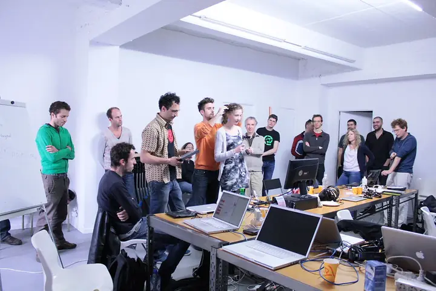

# Tangible Feelings: EEG for the Arts

A traveling workshop on brain–computer interfaces for artists, developed by [Mattia Casalegno](https://www.mattiacasalegno.net) and Enzo Varriale ( [Lanvideosource](https://vimeo.com/lanvideosource) ). Between 2011 and 2013 it taught artists, VJs and designers to read brain activity with EEG headsets and turn it into sound and image, building their own real-time audiovisual tools.

**Project page:** https://aradicalhypothesis.github.io/tangible-feelings/

*Tangible Feelings workshop, iMAL, Brussels, 17–18 September 2011. Photos: iMAL, [CC BY-NC-SA 2.0](https://creativecommons.org/licenses/by-nc-sa/2.0/) ([full set on Flickr](https://www.flickr.com/search/?user_id=8579109%40N08&text=tangible%20feelings%20workshop)). The slideshow is shared under the same licence.*

The workshop began at iMAL in Brussels, as part of the *Tangible Feelings* symposium on EEG and biofeedback for the arts. It drew on two earlier EEG-based works: the audiovisual performance *Sounds of Complexity* (Kinotek, 2004–2007) and the installation *Unstable Empathy* (2010).

## Editions

| Year | City | Host |
|---|---|---|
| 2011 | Brussels | [iMAL](https://www.imal.org/), Center for Digital Cultures and Technology, 17–18 September, part of the *Tangible Feelings* symposium ([archived workshop page](https://web.archive.org/web/20171018042515/http://www.imal.org/en/more/tangible-feelings-workshop)) |
| 2012 | Taipei | [Digital Art Center, Taipei](https://dac.taipei/), 2–4 January, organised by the Transjourney Future Media Festival (Kuandu Museum of Fine Arts, Taipei National University of the Arts). Three-day workshop led by Mattia Casalegno, with Emotiv EPOC and NeuroSky headsets, Max/MSP/Jitter, Processing and Arduino |
| 2012 | Rome | [LPM Live Performers Meeting](https://liveperformersmeeting.net/), Planet Alpheus, 31 May – 3 June: *EmotiVVVV!*, the EEG module of [VVVV & brainwaves for AV performance](https://liveperformersmeeting.net/editions/2012-rome/program/detail/vvvv-brainwaves-for-av-performance-100/) ([vvvv blog](https://vvvv.org/blog/2012/workshop-in-rome-vvvv-brainwaves-for-av)) |
| 2012 | Porto | ARTES, contemporary art programme of the [Fundação Manuel António da Mota](https://www.fmam.pt/), two week-long workshops, 12–16 and 19–23 November, with the support of MuARTs |
| 2013 | Cape Town | [LPM Live Performers Meeting](https://liveperformersmeeting.net/), [Cape Town City Hall](https://en.wikipedia.org/wiki/Cape_Town_City_Hall), 13–16 November: [AV Performances with EEG interfaces](https://liveperformersmeeting.net/editions/2013-cape-town/program/detail/av-performances-with-eeg-interfaces-100-r1250/) |

## Curriculum

Each edition combined a talk with hands-on sessions.

**Talk**
- The EEG signal: alpha, beta, theta and delta waves
- Sampling and digitization of EEG signals
- Real-time data protocols, including OSC
- Designing interfaces for EEG-based media art
- Case studies: *Sounds of Complexity* and *Unstable Empathy*

**Hands-on**
- The Emotiv headset and SDK
- Streaming EEG data over OSC into Max/MSP/Jitter and vvvv
- Basic sonification
- Participants design and build their own EEG-driven audiovisual tools, such as video mixers and sequencers

## In this repository

- `index.html`: the project page, published with GitHub Pages
- `archive/`: original documents: the 2011 talk and workshop proposal to iMAL, and the text and software list of the 2011–2012 workshop wiki
- `assets/slideshow.webp`: the slideshow above, made from iMAL's photos (CC BY-NC-SA 2.0)
- `images/`: photographs from the editions

## Credits

Developed by Mattia Casalegno and Enzo Varriale. With thanks to iMAL (Brussels), the Transjourney Future Media Festival and the Digital Art Center (Taipei), LPM Live Performers Meeting (Rome and Cape Town), and ARTES – Fundação Manuel António da Mota and MuARTs (Porto).

## Licence

Text: [Creative Commons Attribution 4.0 (CC BY 4.0)](LICENSE.md). Photographs keep their own licences and credits, as stated with each image.
